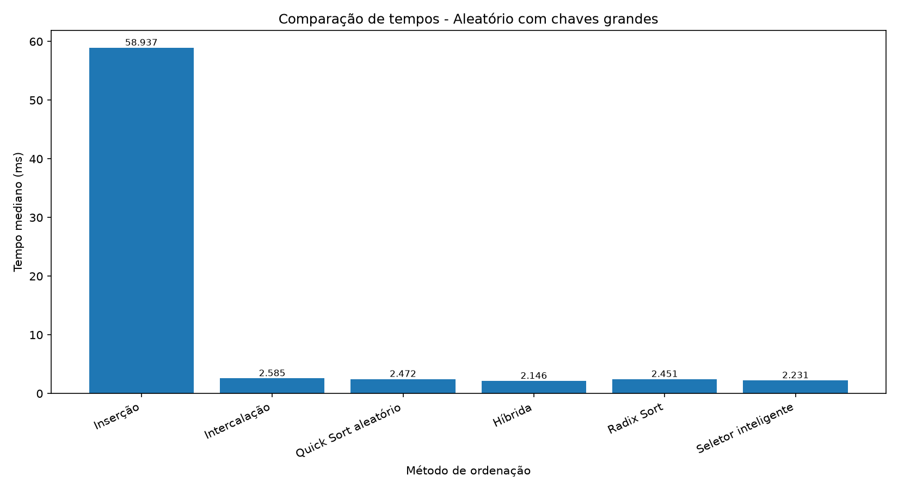
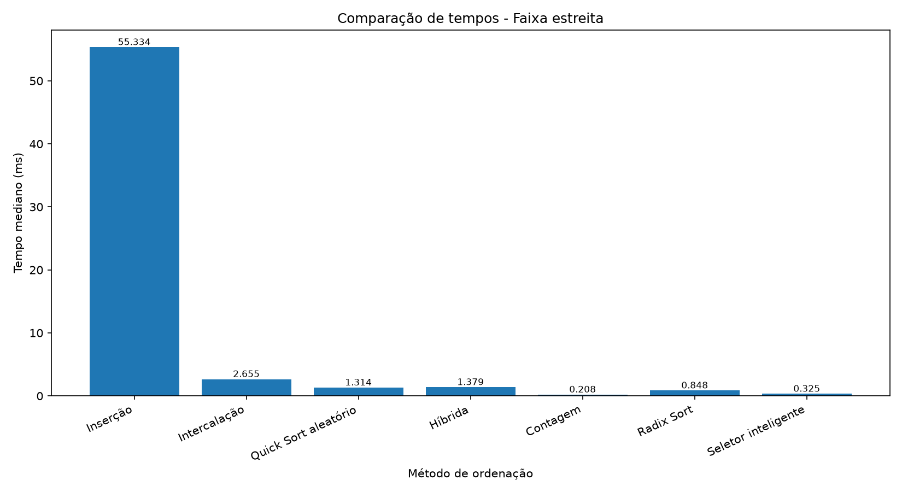
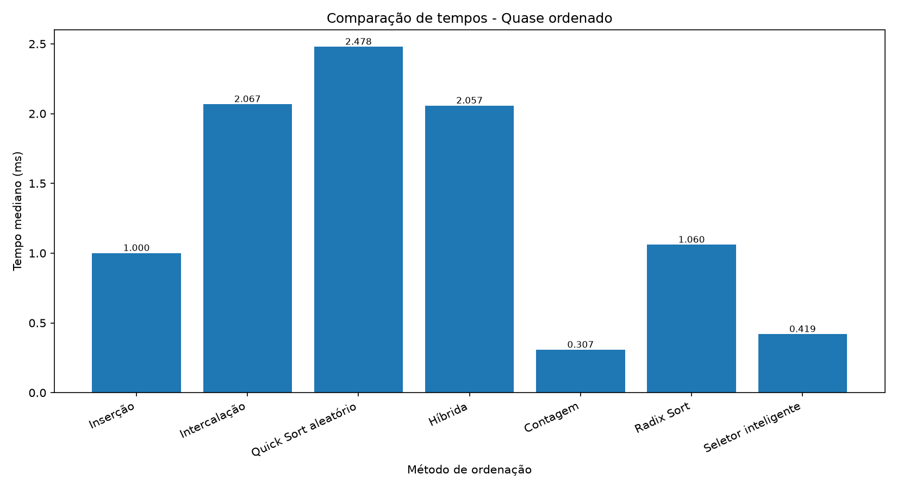
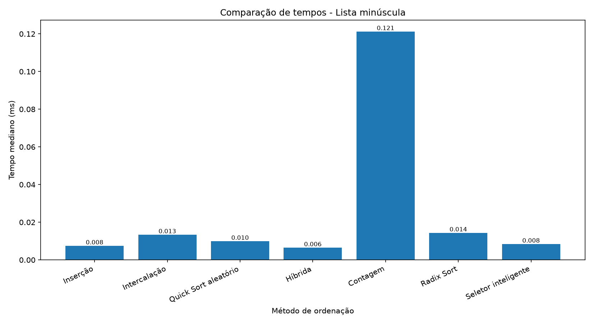

# Escolhedor de Ordenação

Projeto desenvolvido em Python para implementar, testar e comparar diferentes algoritmos de ordenação, além de criar um seletor inteligente capaz de escolher um algoritmo com base nas características da lista de entrada.

O objetivo é analisar como diferentes algoritmos se comportam em cenários variados e verificar se a escolha automática pode oferecer bons resultados de desempenho.

## Objetivos

- Implementar seis métodos de ordenação.
- Testar a corretude dos algoritmos.
- Comparar os tempos de execução em diferentes cenários.
- Analisar o impacto do tamanho da lista e da distribuição dos valores.
- Desenvolver um seletor inteligente de algoritmos.
- Registrar os resultados em CSV e apresentar os dados por meio de gráficos.

## Algoritmos implementados

| Algoritmo | Descrição | Complexidade de tempo |
|---|---|---|
| Inserção | Insere cada elemento na posição correta da parte já ordenada. | \(O(n^2)\) no pior caso; \(O(n)\) no melhor caso |
| Intercalação (Merge Sort) | Divide a lista em partes menores, ordena e intercala os resultados. | \(O(n \log n)\) |
| Quick Sort aleatório | Utiliza um pivô escolhido aleatoriamente para particionar a lista. | \(O(n \log n)\) em média; \(O(n^2)\) no pior caso |
| Ordenação Híbrida | Combina estratégias de ordenação para aproveitar suas vantagens. | Depende da implementação |
| Contagem (Counting Sort) | Conta as ocorrências dos valores dentro de uma faixa limitada. | \(O(n+k)\) |
| Radix Sort | Ordena números considerando seus dígitos ou posições. | \(O(d(n+b))\) |

**Legenda:** \(n\) representa a quantidade de elementos; \(k\), a amplitude da faixa de valores; \(d\), a quantidade de posições ou dígitos processados; e \(b\), a base utilizada pelo Radix Sort.

As complexidades representam o comportamento teórico geral dos algoritmos. O desempenho real também depende da implementação e dos dados utilizados.

## Seletor Inteligente

O projeto possui um seletor que analisa as características da lista e escolhe um método de ordenação entre as opções implementadas no seletor.

As regras de escolha seguem esta ordem:

1. **Lista pequena:** para listas com até 32 elementos, escolhe Inserção.
2. **Faixa de valores estreita:** escolhe Contagem quando a amplitude dos valores é de, no máximo, duas vezes o tamanho da lista e não ultrapassa 100.000.
3. **Lista quase ordenada:** escolhe Inserção quando a proporção de posições em ordem decrescente é de até 5%.
4. **Demais situações:** escolhe a Ordenação Híbrida.

O seletor considera essas condições na ordem apresentada. O tempo de análise também deve ser considerado ao avaliar o desempenho total da solução.

## Metodologia dos experimentos

Os experimentos comparam os métodos de ordenação em quatro cenários:

| Cenário | Características |
|---|---|
| Aleatório com chaves grandes | Lista aleatória de 2.000 elementos com valores grandes. |
| Faixa estreita | Lista de 2.000 elementos com valores em uma faixa pequena. |
| Quase ordenado | Lista de 2.000 elementos com poucos elementos fora de ordem. |
| Lista minúscula | Lista de apenas 20 elementos. |

Os experimentos são executados com repetições para permitir a comparação dos tempos medianos. O método Contagem é ignorado no cenário de chaves grandes quando a amplitude ultrapassa o limite definido na implementação.

O Seletor Inteligente também é avaliado, considerando o tempo de análise e o tempo de ordenação.

## Resultados gráficos

Os gráficos a seguir apresentam a comparação dos tempos medianos de execução, em milissegundos (ms), nos quatro cenários.

### 1. Aleatório com chaves grandes

Neste cenário, a Ordenação por Inserção apresenta um tempo significativamente maior que os demais métodos. A Ordenação Híbrida apresentou o menor tempo entre os métodos fixos nesta execução.



### 2. Faixa estreita

Neste cenário, a Ordenação por Contagem apresentou excelente desempenho, pois os valores estão concentrados em uma faixa pequena.



### 3. Quase ordenado

A Ordenação por Contagem apresentou o menor tempo nesta execução. A Ordenação por Inserção também teve bom desempenho, demonstrando sua utilidade em listas quase ordenadas.



### 4. Lista minúscula

Para uma lista de apenas 20 elementos, os tempos são muito pequenos. A Ordenação Híbrida apresentou o menor tempo entre os métodos fixos nesta execução, enquanto o seletor escolheu Inserção.



## Análise dos resultados

Os experimentos mostram que o desempenho depende das características da entrada:

- A Inserção pode ser eficiente em listas pequenas ou quase ordenadas, mas tende a apresentar desempenho inferior em listas grandes e desordenadas.
- A Intercalação e o Quick Sort oferecem desempenho consistente em muitos cenários, embora seus resultados dependam da implementação e dos dados.
- A Ordenação Híbrida apresentou bons resultados nos cenários testados.
- A Ordenação por Contagem se destacou quando a faixa de valores era pequena, mas não foi utilizada para chaves grandes devido ao limite configurado.
- O Radix Sort apresentou bons resultados em alguns cenários, especialmente quando comparado a algoritmos quadráticos.
- O Seletor Inteligente permite adaptar a escolha do algoritmo às características da entrada, mas o custo de análise também influencia o tempo total.

Os resultados apresentados correspondem a uma execução dos experimentos. Os tempos podem variar de acordo com o computador, a carga do sistema e as condições de execução.

## Estrutura do projeto

```text
OrdenacaoInteligente/
├── ordenacoes.py
├── seletor.py
├── testes.py
├── experimentos.py
├── graficos.py
├── resultados.csv
├── grafico_cenario_1.png
├── grafico_cenario_2.png
├── grafico_cenario_3.png
├── grafico_cenario_4.png
├── DIARIO.md
├── RELATORIO.md
├── README.md
└── .gitignore
```

### Descrição dos arquivos

- `ordenacoes.py`: implementações dos algoritmos de ordenação.
- `seletor.py`: análise da lista e seleção do algoritmo.
- `testes.py`: testes de corretude dos algoritmos e do seletor.
- `experimentos.py`: execução dos benchmarks e geração dos resultados.
- `graficos.py`: geração dos gráficos a partir do arquivo CSV.
- `resultados.csv`: dados produzidos pelos experimentos.
- `grafico_cenario_*.png`: gráficos de comparação dos tempos.
- `DIARIO.md`: registro do desenvolvimento do projeto.
- `RELATORIO.md`: relatório com a metodologia e a análise dos resultados.

## Requisitos

- Python 3 instalado.
- Biblioteca Matplotlib para geração dos gráficos.

Instale a dependência com:

```bash
python -m pip install matplotlib
```

## Como executar

Execute os comandos no terminal, dentro da pasta do projeto.

### 1. Executar os testes

```bash
python testes.py
```

### 2. Executar os experimentos

```bash
python experimentos.py
```

Esse comando executa os benchmarks e registra os resultados em `resultados.csv`.

### 3. Gerar os gráficos

```bash
python graficos.py
```

Os gráficos são salvos nos arquivos `grafico_cenario_1.png` até `grafico_cenario_4.png`.

## Conclusão

O projeto permite estudar, na prática, as diferenças entre algoritmos de ordenação e a influência das características da entrada sobre o desempenho.

Os resultados reforçam que não existe um único algoritmo ideal para todas as situações. Um seletor inteligente pode ajudar a escolher uma estratégia adequada, desde que suas regras e o custo de análise sejam considerados.

O trabalho reúne implementação, testes, experimentação, análise de desempenho e visualização dos resultados, oferecendo uma base prática para o estudo de algoritmos e estruturas de dados.